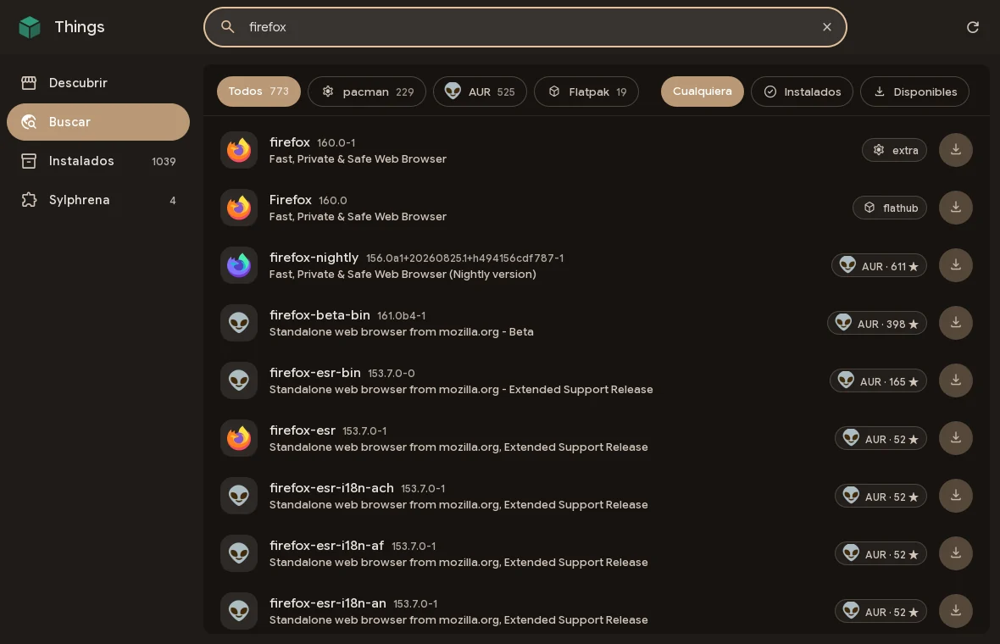

<h1 align="center">Things</h1>

<p align="center"><a href="./README.md">English</a> · <strong>Español</strong></p>

<p align="center">
El gestor de paquetes <strong>Material You</strong> de <a href="https://github.com/iMacnucintosh/lunele-shell">Lunele</a>: pacman, AUR y Flatpak en <strong>una sola lista</strong>, y además las extensiones de la shell.
</p>

<p align="center"></p>

- Producto y nombre en el lanzador: **Things**
- Stack: **Qt 6 Quick / QML + C++20** (qmake), sin más dependencias que Qt
- Binario: `~/.local/bin/things` · config: `~/.config/things/`
- Es el «Octopi moderno y mínimo»: buscar, ver instalados, instalar, eliminar. Las actualizaciones del sistema completo siguen en Ajustes → Actualizaciones; Things solo marca qué paquetes las tienen.

## Funciones

- **Descubrir (pantalla inicial)**: estilo tienda de aplicaciones: una destacada del día con su captura de pantalla y filas de **Tendencias**, **Más instaladas** (último mes), **Novedades** y **Actualizadas hace poco**, con iconos reales. Los datos salen de la API pública de Flathub (sin cuenta ni datos tuyos), se guardan en caché (`~/.cache/things/`, se renueva cada hora) y funcionan sin conexión con los últimos datos. Además, **Populares en Arch**: las aplicaciones de los repos oficiales ordenadas por cuántos usuarios las tienen instaladas ([pkgstats](https://pkgstats.archlinux.de)), con nombre y resumen en tu idioma e icono del tema. Necesita el paquete `archlinux-appstream-data` (catálogo oficial de Arch, ~20 MB): si falta, Descubrir ofrece instalarlo con un botón. Se excluyen herramientas de desarrollo/sistema y dependencias que casi todo el mundo tiene, que no son una recomendación. Al escribir en el buscador salta a los resultados; `Esc` vuelve.
- **Búsqueda unificada**: pacman (repos), AUR (RPC oficial, con `yay -Ssa` de respaldo sin red) y Flatpak/Flathub a la vez, asíncrona, con *debounce* de 250 ms y cancelación (los resultados de búsquedas viejas se descartan y sus procesos se matan). Sin botones para «activar AUR».
- **Ranking útil**: coincidencia exacta e instalados primero; los orígenes se mezclan, no se apilan en bloques. Votos/popularidad pesan en AUR.
- **Origen siempre visible**: pacman = `settings`, Flatpak = `deployed_code`, AUR = 👽 (mismos glifos que la página Actualizaciones de Ajustes), más un chip con el repo (`core`/`extra`/`multilib`/remoto Flatpak) o los votos de AUR.
- **Iconos reales**: si el tema de iconos (Papirus vía qt6ct) tiene icono para el paquete o el id de Flatpak, se muestra; si no, el glifo de origen.
- **Filtros**: origen (Todos · pacman · AUR · Flatpak, con contadores) y estado (Cualquiera · Instalados · Disponibles).
- **Instalados**: explícitos, dependencias y huérfanos (`pacman -Qdt`), AUR (foráneos) y Flatpak, con filtro por origen y búsqueda local.
- **Actualizaciones pendientes**: los paquetes instalados con versión nueva se marcan («2.19.2-1 → 2.19.3-1») y tienen su filtro «Actualizaciones» en Instalados; su ficha lo dice con un botón que abre Ajustes → Actualizaciones. Things no comprueba nada por su cuenta: pide a la shell la misma lista que enseñan la barra y Ajustes (`qs ipc call updates list`, Lunele 0.5.7 o posterior) y la vuelve a pedir al volver a la ventana. Actualizar sigue siendo cosa de la shell (una contraseña, en segundo plano).
- **Detalle**: descripción, versión, web, licencias, tamaños, dependencias (opcionales, requerido por…), motivo de instalación, ficha de AUR/Flathub y lista de archivos instalados.
- **Detalle con capturas (Flatpak)**: el panel de una app de Flathub muestra su galería de capturas de pantalla (con pie de foto, flechas y puntos; clic para verlas a pantalla completa, `←`/`→` para pasar, `Esc` para cerrar), «Acerca de» con la descripción completa, las novedades de la última versión y enlaces (web, ayuda, reportar un fallo, donar). Solo se contacta con `dl.flathub.org` para las imágenes. Los paquetes de pacman/AUR no tienen capturas: las del catálogo de Arch están en webs de terceros y no se cargan.
- **Instalar / eliminar**: cola serie con progreso, salida en vivo plegable, cancelación (SIGINT limpio → SIGTERM → SIGKILL) y errores diagnosticados (bloqueo `db.lck`, bases desactualizadas, dependencias, conflictos, firmas…).
- **Confirmación con vista previa real**: `pacman -S --print` / `pacman -Rs --print` (dependencias que entran o se van y tamaño), `flatpak remote-info`.
- **Lunele (extensiones de la shell)**: sección propia en la columna lateral (`Ctrl+4`), con la versión de Lunele que corre junto al título, con las extensiones del [Lunele Hub](https://github.com/iMacnucintosh/lunele-hub): disponibles, instaladas, **actualizables** (con contador) y **locales** (puestas a mano: Things las muestra y no las toca salvo que pidas quitarlas). Instalar, actualizar y quitar pasan por la misma cola, confirmación y registro en vivo que los paquetes. **Things no instala nada por su cuenta**: lanza `scripts/ext.py` de la shell, que descarga solo de las releases del hub, comprueba el `sha256` del catálogo y la compatibilidad, valida el zip, instala las piezas de sistema con `sudo -A` (la contraseña la pide el diálogo de Things y solo si la extensión lo necesita) y avisa a la shell. El catálogo (`index.json`) se pide al hub al abrir (la caché solo pinta el primer fotograma y sirve sin conexión); cada entrada se valida antes de mostrarse. Si no se encuentra Lunele, se ve el catálogo pero no se instala.
  - **Detalles**: al pulsar una extensión se abre su ficha (descripción larga, capturas, requisitos, qué toca en tu equipo y novedades), que Things descarga del hub (`store/<id>.json`, solo de sus URLs).
  - Una copia **local** que el hub también tiene (puesta a mano o desde un zip) se puede cambiar por la del hub con «Usar la del hub», para que Things la actualice; tus ajustes y datos se conservan.
  - **Instalar desde zip** (botón de la cabecera) abre el selector de Seeker, enseña qué trae el zip (nombre, versión, descripción, si pide contraseña) y pide confirmación; la extensión queda como «local». Lo valida `ext.py inspect`/`install` de la shell.
- **Tema**: Material You en vivo desde Lunele (`theme.json`, claro u oscuro según diga el fichero).

### Teclado

| Atajo | Acción |
| --- | --- |
| `Ctrl+L` / `Ctrl+F` | Enfocar la búsqueda |
| `↓` en la búsqueda | Pasar a la lista (`↑` en la primera fila, vuelve) |
| `Enter` en la lista | Abrir detalle |
| `Esc` | Cerrar detalle → limpiar búsqueda |
| `Ctrl+1` / `Ctrl+2` / `Ctrl+3` / `Ctrl+4` | Descubrir / Buscar / Instalados / Lunele |
| `F5` | Refrescar instalados y repetir búsqueda |

Opciones de línea de comandos: `--search <texto>`, `--installed`, `--dry-run`.

## Instalación

Viene con Lunele: [su instalador](https://github.com/iMacnucintosh/lunele-shell/blob/main/README.es.md#instalación) lo instala. Por separado, en Arch Linux, añade el [repositorio de paquetes de Lunele](https://github.com/iMacnucintosh/lunele-packages) e instálalo con pacman:

```sh
sudo pacman -S things-git
```

## Compilar desde el código

```sh
git clone https://github.com/iMacnucintosh/things
cd things
qmake6 PREFIX=$HOME/.local
make -j$(nproc)
make install
```

Instala `things`, `things.desktop` («Things») y `things.svg` en `~/.local`.

## Integración con Lunele

- **Tema**: Things lee `~/.config/things/theme.json` (mismo formato que Seeker: `mode` + paleta Material + `transparency`) y lo recarga en caliente. Lo escribe `_sync_things` en `scripts/lunele-quiet.py` de Lunele en cada apply. Sin fichero usa una paleta oscura por defecto.
- **Extensiones**: es el gestor de extensiones de la shell (ver arriba); el contrato entre ambos vive en el `AGENTS.md` de Lunele.
- **Actualizaciones**: pregunta a la shell qué paquetes tienen una nueva versión (`qs ipc call updates list`).

## Privilegios

No se usa polkit. Sigue el patrón del servicio Updates de Lunele, en C++:

1. Diálogo propio de contraseña (Material You) cuando una operación necesita root.
2. Verificación con `sudo -k` + `sudo -S -p '' -v` (contraseña por stdin, que se cierra: sudo nunca queda esperando).
3. La contraseña vive **solo en la RAM** del proceso `things` y se sirve por un socket Unix privado (`$XDG_RUNTIME_DIR/things-askpass-*.sock`, 0600, con comprobación `SO_PEERCRED`). El programa askpass es el propio binario (`SUDO_ASKPASS=~/.local/bin/things` + `THINGS_ASKPASS_SOCK`).
4. Las operaciones corren con `sudo -A …` / `yay --sudoflags=-A`. Nunca `--sudoloop` (bloquea con faillock) ni `sudo -n` (el timestamp es por TTY).
5. La contraseña se borra tras 5 minutos de inactividad o al salir. Los procesos hijos arrancan con stdin en `/dev/null`.

Flatpak: se instala **a nivel sistema** si existe un remote de sistema (lo normal con Flathub); solo a nivel usuario (sin sudo) si la máquina solo tiene remotes de usuario. Eliminar respeta dónde está instalado el paquete.

**Eliminar deja el sistema limpio:**

- pacman / AUR: `pacman -Rns`: quita el paquete, las dependencias que ya nadie necesita y sus archivos de configuración de sistema. Las dependencias que usa otro paquete, o que instalaste a mano, se quedan.
- Flatpak: desinstala la app y después los runtimes que ninguna otra aplicación use (`flatpak uninstall --unused`). Los datos de la app en `~/.var/app` solo se borran si marcas «Borrar también los datos» en la confirmación (desmarcado por defecto, no se puede deshacer).
- Nunca toca tus datos personales (`~/.config`, `~/.local/share`).

Seguridad de argumentos: ningún `sh -c` con contenido de usuario; todo va por argv, y los nombres de paquete se validan con expresiones regulares conservadoras antes de lanzar nada.

## Desarrollo

Pruebas sin tocar el sistema:

```sh
./things --dry-run               # install/remove simulados (THINGS_DRY_FAIL=1 simula un fallo)
./things --dump-search blender   # búsqueda unificada en texto (sin GUI)
./things --dump-installed --filter-kind dep
./things --dump-detail aur:yay
./things --dump-hub              # filas del hub de Lunele (THINGS_HUB_INDEX=<index.json> lo lee de un fichero en vez de la red)
./things --hub-op install:<id>   # (dev) encola una operación del hub sin hacer clic; con THINGS_HUB_INDEX y
                                 # LUNELE_HUB_TEST_PREFIX=file://<carpeta de zips> se prueba todo el flujo en local
dev/run-demos.sh                 # capturas offscreen: recorrido de la UI + flujo de contraseña con un sudo falso
```

```
src/Backend.*       búsqueda unificada, instalados y detalle (QProcess + QNetworkAccessManager)
src/HubCatalog.*    catálogo del hub de Lunele (índice, caché, validación) cruzado con lo instalado
src/Operations.*    cola de instalar/eliminar, salida en vivo, vistas previas y diagnóstico de errores
src/Privilege.*     contraseña en RAM + socket askpass
src/Theme.*         tema en vivo desde theme.json
qml/                Main.qml + components (Material You, copiados/adaptados de Seeker)
```

## Idiomas

El código está en inglés (`qsTr("…")`, `tr("…")`) y cada idioma es un catálogo JSON en `i18n/<idioma>.json` (texto en inglés → traducción; una clave `contexto\u0004texto` distingue dos traducciones del mismo texto). Hoy: español (`es`). Un idioma sin catálogo se ve en inglés; `THINGS_LANG=es` fuerza uno. `scripts/check-i18n.py` comprueba que no falta ni sobra ninguna cadena.

## Licencia

MIT, ver [LICENSE](LICENSE).
