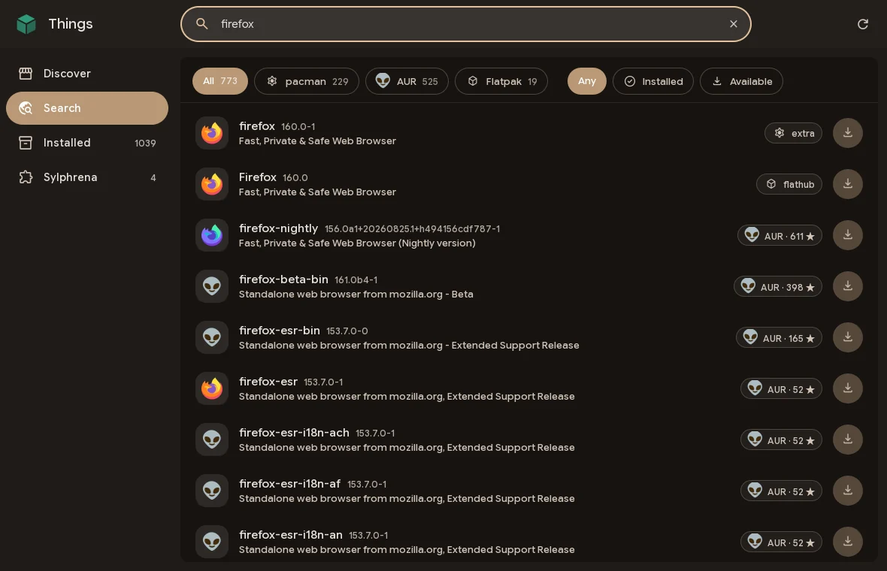

<h1 align="center">Things</h1>

<p align="center"><strong>English</strong> · <a href="./README.es.md">Español</a></p>

<p align="center">
The <strong>Material You</strong> package manager of <a href="https://github.com/iMacnucintosh/sylenara-shell">Sylenara</a>: pacman, the AUR and Flatpak in <strong>one list</strong>, plus the extensions of the shell.
</p>

<p align="center"></p>

- Product and launcher name: **Things**
- Stack: **Qt 6 Quick / QML + C++20** (qmake), with no dependencies besides Qt
- Binary: `~/.local/bin/things` · config: `~/.config/things/`
- It is the "modern and minimal Octopi": search, see what is installed, install, remove. Updating the whole system stays in Settings → Updates; Things only marks which packages have an update.

## Features

- **Discover (home page)**: app-store style: an app of the day with its screenshot and rows of **Trending**, **Most installed** (last month), **New** and **Recently updated**, with real icons. The data comes from Flathub's public API (no account, none of your data), is cached (`~/.cache/things/`, renewed every hour) and works offline with the latest data. Also **Popular on Arch**: the apps of the official repositories sorted by how many users have them installed ([pkgstats](https://pkgstats.archlinux.de)), with name and summary in your language and the theme's icon. It needs the `archlinux-appstream-data` package (Arch's official catalogue, ~20 MB): if it is missing, Discover offers to install it with a button. Development/system tools and dependencies almost everybody has are left out: they are not a recommendation. Typing in the search box jumps to the results; `Esc` goes back.
- **Unified search**: pacman (repositories), the AUR (official RPC, with `yay -Ssa` as a fallback offline) and Flatpak/Flathub at once, asynchronous, with a 250 ms debounce and cancellation (the results of old searches are discarded and their processes killed). No "enable AUR" buttons.
- **Useful ranking**: exact matches and installed packages first; the origins are mixed, not stacked in blocks. Votes/popularity weigh on the AUR.
- **Origin always visible**: pacman = `settings`, Flatpak = `deployed_code`, AUR = 👽 (the same glyphs as Settings' Updates page), plus a chip with the repository (`core`/`extra`/`multilib`/Flatpak remote) or the AUR votes.
- **Real icons**: if the icon theme (Papirus via qt6ct) has an icon for the package or the Flatpak id, it shows; otherwise the origin glyph.
- **Filters**: origin (All · pacman · AUR · Flatpak, with counters) and state (Any · Installed · Available).
- **Installed**: explicit, dependencies and orphans (`pacman -Qdt`), AUR (foreign) and Flatpak, with an origin filter and local search.
- **Pending updates**: installed packages with a new version are marked ("2.19.2-1 → 2.19.3-1") and have their own "Updates" filter in Installed; their page says so with a button that opens Settings → Updates. Things checks nothing by itself: it asks the shell for the same list the bar and Settings show (`qs ipc call updates list`, Sylenara 0.5.7 or later) and asks again when you come back to the window. Updating stays the shell's job (one password, in the background).
- **Details**: description, version, web, licences, sizes, dependencies (optional, required by…), install reason, AUR/Flathub page and the list of installed files.
- **Flatpak details with screenshots**: the page of a Flathub app shows its screenshot gallery (with captions, arrows and dots; click to see them full screen, `←`/`→` to move, `Esc` to close), "About" with the full description, the news of the latest version and links (web, help, report a bug, donate). `dl.flathub.org` is only contacted for the images. pacman/AUR packages have no screenshots: the ones in Arch's catalogue are on third-party sites and are not loaded.
- **Install / remove**: a serial queue with progress, collapsible live output, cancellation (clean SIGINT → SIGTERM → SIGKILL) and diagnosed errors (`db.lck` lock, outdated databases, dependencies, conflicts, signatures…).
- **Confirmation with a real preview**: `pacman -S --print` / `pacman -Rs --print` (dependencies that come in or go and the size), `flatpak remote-info`.
- **Sylenara (shell extensions)**: its own section in the side column (`Ctrl+4`), with the version of Sylenara that is running next to the title, with the extensions of the [Sylenara Hub](https://github.com/iMacnucintosh/sylenara-hub): available, installed, **updatable** (with a counter) and **local** (put there by hand: Things shows them and does not touch them unless you ask to remove them). Installing, updating and removing go through the same queue, confirmation and live log as packages. **Things installs nothing by itself**: it runs the shell's `scripts/ext.py`, which downloads only from the hub's releases, checks the catalogue's `sha256` and the compatibility, validates the zip, installs the system parts with `sudo -A` (the password is asked by Things' dialog, and only if the extension needs it) and tells the shell. The catalogue (`index.json`) is requested from the hub on opening (the cache only paints the first frame and serves offline); every entry is validated before it shows. If Sylenara cannot be found, the catalogue is visible but nothing installs.
  - **Details**: clicking an extension opens its page (long description, screenshots, requirements, what it touches on your computer and news), which Things downloads from the hub (`store/<id>.json`, only from its URLs).
  - A **local** copy that the hub also has (put there by hand or from a zip) can be swapped for the hub's with "Use the hub's", so Things updates it; your settings and data are kept.
  - **Install from zip** (the header button) opens Seeker's picker, shows what the zip brings (name, version, description, whether it asks for a password) and asks for confirmation; the extension stays "local". It is validated by the shell's `ext.py inspect`/`install`.
- **Theme**: Material You, live from Sylenara (`theme.json`, light or dark as the file says).

### Keyboard

| Shortcut | Action |
| --- | --- |
| `Ctrl+L` / `Ctrl+F` | Focus the search |
| `↓` in the search | Go to the list (`↑` on the first row goes back) |
| `Enter` in the list | Open the details |
| `Esc` | Close the details → clear the search |
| `Ctrl+1` / `Ctrl+2` / `Ctrl+3` / `Ctrl+4` | Discover / Search / Installed / Sylenara |
| `F5` | Refresh the installed list and repeat the search |

Command line options: `--search <text>`, `--installed`, `--dry-run`.

## Install

It comes with Sylenara: [its installer](https://github.com/iMacnucintosh/sylenara-shell#installation) sets it up. On its own, on Arch Linux, add the [Sylenara package repository](https://github.com/iMacnucintosh/sylenara-packages) and install it with pacman:

```sh
sudo pacman -S things-git
```

## Build from source

```sh
git clone https://github.com/iMacnucintosh/things
cd things
qmake6 PREFIX=$HOME/.local
make -j$(nproc)
make install
```

It installs `things`, `things.desktop` ("Things") and `things.svg` into `~/.local`.

## Sylenara integration

- **Theme**: Things reads `~/.config/things/theme.json` (the same format as Seeker: `mode` + the Material palette + `transparency`) and reloads it live. Sylenara's `scripts/sylenara-quiet.py` writes it (`_sync_things`) with every apply. Without the file it uses a dark palette.
- **Extensions**: it is the extension manager of the shell (see above); the contract between the two lives in Sylenara's `AGENTS.md`.
- **Updates**: it asks the shell which packages have an update (`qs ipc call updates list`).

## Privileges

polkit is not used. It follows the pattern of Sylenara's Updates service, in C++:

1. Its own Material You password dialog when an operation needs root.
2. Verification with `sudo -k` + `sudo -S -p '' -v` (the password goes through stdin, which is closed: sudo never stays waiting).
3. The password lives **only in the RAM** of the `things` process and is served over a private Unix socket (`$XDG_RUNTIME_DIR/things-askpass-*.sock`, 0600, with an `SO_PEERCRED` check). The askpass program is the binary itself (`SUDO_ASKPASS=~/.local/bin/things` + `THINGS_ASKPASS_SOCK`).
4. Operations run with `sudo -A …` / `yay --sudoflags=-A`. Never `--sudoloop` (it blocks with faillock) nor `sudo -n` (the timestamp is per TTY).
5. The password is erased after 5 minutes of inactivity or on exit. Child processes start with stdin on `/dev/null`.

Flatpak: it installs **system-wide** if there is a system remote (the usual case with Flathub); user-only (no sudo) if the machine only has user remotes. Removing respects where the package is installed.

**Removing leaves the system clean:**

- pacman / AUR: `pacman -Rns`: it removes the package, the dependencies nobody needs any more and its system configuration files. Dependencies used by another package, or that you installed by hand, stay.
- Flatpak: it uninstalls the app and then the runtimes no other application uses (`flatpak uninstall --unused`). The app's data in `~/.var/app` is only deleted if you tick "Also delete the data" in the confirmation (unticked by default, it cannot be undone).
- It never touches your personal data (`~/.config`, `~/.local/share`).

Argument safety: no `sh -c` with user content; everything goes through argv, and package names are validated with conservative regular expressions before anything runs.

## Development

Try it without touching the system:

```sh
./things --dry-run               # simulated install/remove (THINGS_DRY_FAIL=1 simulates a failure)
./things --dump-search blender   # the unified search as text (no GUI)
./things --dump-installed --filter-kind dep
./things --dump-detail aur:yay
./things --dump-hub              # the rows of the Sylenara hub (THINGS_HUB_INDEX=<index.json> reads it from a file instead of the network)
./things --hub-op install:<id>   # (dev) queues a hub operation without clicking; with THINGS_HUB_INDEX and
                                 # SYLENARA_HUB_TEST_PREFIX=file://<zips folder> the whole flow is tested locally
dev/run-demos.sh                 # offscreen screenshots: a tour of the UI + the password flow with a fake sudo
```

```
src/Backend.*       unified search, installed and details (QProcess + QNetworkAccessManager)
src/HubCatalog.*    the Sylenara hub catalogue (index, cache, validation) crossed with what is installed
src/Operations.*    install/remove queue, live output, previews and error diagnosis
src/Privilege.*     password in RAM + askpass socket
src/Theme.*         live theme from theme.json
qml/                Main.qml + components (Material You, copied/adapted from Seeker)
```

## Languages

The code is in English (`qsTr("…")`, `tr("…")`) and each language is a JSON catalogue in `i18n/<language>.json` (English text → translation; a `context\u0004text` key tells apart two translations of the same text). Today: Spanish (`es`). A language without a catalogue shows in English; `THINGS_LANG=es` forces one. `scripts/check-i18n.py` checks that no string is missing or left over.

## License

GPL-3.0-only, see [LICENSE](LICENSE). Copyright (C) 2026 Manuel López Mallorquín. Credits in [NOTICE](NOTICE).
